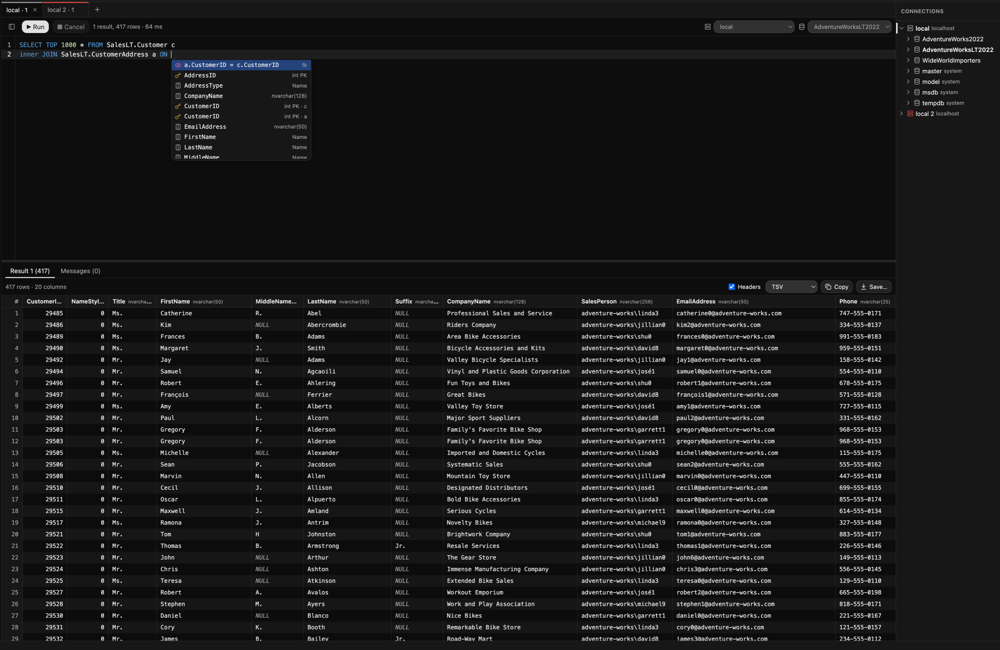

# SeaQull

A SQL Server client for [Orca](https://github.com/stablyai/orca). Browse your databases, write
queries with completion, run them in workbook tabs and copy or export the results, all without
leaving Orca.

## Features

- **Object explorer** beside the editor: connections, databases, schemas, tables, views,
  procedures, functions and columns. Right-click for *Select top 100 rows*, *Insert SELECT/EXEC
  statement*, *Insert name* and *Copy name*.
- **Workbooks** (`.seaqull` files) with several query tabs, each with its own connection and
  database. `.sql` files can be opened in the SeaQull console too.
- **Completion** for keywords, built-in functions, and the objects and columns of the tab's database
  (with types and primary keys). After a JOIN's `ON`, it suggests whole join conditions from the
  foreign keys.
- **One SQL session per tab.** Temp tables, `SET` options and transactions carry over from one run to the next.
- **Result grid** with several result sets and messages per run. Select cells, rows or columns,
  copy them, or copy and save whole results as CSV, TSV, JSON, JSON Lines, Markdown or SQL `INSERT`
  statements.
- **Exact values.** `decimal`, `numeric` and `money` are shown exactly, with no floating-point
  rounding, and `datetimeoffset` keeps its offset.
- **Sign-in** with a SQL Server login or with Microsoft Entra ID through the Azure CLI (no password
  stored). A SQL login's user and password are optional: leave them out and SeaQull asks when it
  connects, and keeps them in your OS keychain only if you tick *Remember*.
- **Coloured connections**, so production stands out from development.
- **Connection folders.** Give a connection a folder such as `Clients/Acme` to group it in the
  explorer and the connection picker. Names stay unique across folders, because workbooks refer
  to connections by name.
- **Export and import connections** as a JSON file, all of them or one folder, to move them to
  another machine or keep a backup. Passwords are never exported. Imports only add: a connection
  that is already there is skipped, and one whose name is taken is added as "Name (2)".

## Requirements

- Orca 1.4.248 or newer (desktop app)
- SQL Server or Azure SQL Database
- For Microsoft Entra ID sign-in: the [Azure CLI](https://learn.microsoft.com/cli/azure/install-azure-cli), signed in with `az login`

## Install

SeaQull is listed in Orca's community plugin catalog.

1. In Orca, open **Settings → Plugins** and turn plugins on, if they are off.
2. Add the community catalog if you haven't already. Its URL is
   `https://github.com/stablyai/orca-community-plugins.git` and its ref is `main`.
3. Find **SeaQull**, press **Install**, and approve **Full access**. [Why SeaQull needs full access](#why-full-access) explains what that means.

Orca keeps the plugin up to date if *Update plugins automatically* is on.

## Getting started

1. Create a workbook with **New SeaQull workbook**, or open a `.sql` file and switch its view
   to **SeaQull console**.
2. Add a connection with the **+** button in the explorer. Enter the server (a host name or an IP
   address) and port, then choose how to sign in. **Test** checks the settings without saving them.
3. Pick the connection and database in the toolbar, write a query and press **⌘↵** (Ctrl+Enter).

## Keyboard shortcuts

| Action | macOS | Windows / Linux |
|---|---|---|
| Run the selection, or the whole tab | ⌘↵ | Ctrl+Enter |
| Cancel the running query | ⌘. | Ctrl+. |
| Open completion | ⌘I, Ctrl+Space or ⌥\` | Ctrl+I or Ctrl+Space |
| Show the name under the cursor in the explorer | ⌥F1 (fn+⌥F1 on most Mac keyboards) | Alt+F1 |
| Find | ⌘F | Ctrl+F |
| Undo / redo (per query tab) | ⌘Z / ⇧⌘Z | Ctrl+Z / Ctrl+Shift+Z |
| Copy the selected cells (TSV) | ⌘C | Ctrl+C |
| Move focus out of the editor | Esc, then Tab | Esc, then Tab |
| Toggle Tab-moves-focus mode | ⇧⌥M | Ctrl+M |

## How it works

**Workbooks.** A `.seaqull` file is JSON that holds each tab's name, SQL, connection, database and
id. Connections are referred to by name, so a workbook works on any machine that has connections
with the same names. In the SeaQull console, a `.sql` file is a single tab, and its connection and
database are kept in a `-- seaqull: …` comment on its first line.

**Sessions.** Each tab has its own SQL Server session. A session ends when its tab closes or switches
connection or database, after 30 minutes idle, when the connection drops or is edited, or when
Orca stops the plugin. SeaQull never ends an idle session that has a transaction open. Once a session
has ended, the tab's next run starts with a notice that its temp tables are gone and any open
transaction was rolled back.

Each tab's id names its session, so a copied workbook shares sessions and results with the
original. To give the copy its own, delete the `id` values in it.

**Status bar.** A SeaQull item appears in Orca's status bar when a query has been running for more
than 3 seconds, or while a session holds an open transaction. It goes away when that ends.

**Limits.** Results keep up to the row limit in Settings (10,000 rows by default). Past that the batch
is stopped, so a `SELECT *` on a large table stays responsive. The explorer shows up to 500
items per level. Completion doesn't cover temp tables, table variables, CTEs or objects in other
databases.

## Settings

| Setting | Default | |
|---|---|---|
| Row limit per result | 10,000 | Rows kept per result set; exports contain the rows kept |
| Explorer position | Left | Which side of the console the explorer is on |
| Azure CLI path | (search) | Full path to `az`. When empty, SeaQull searches `PATH`, `/opt/homebrew/bin` and `/usr/local/bin` |

## Why full access

Orca runs SeaQull as a *trusted worker*: a Node.js process with your user's permissions. Orca's
sandboxed plugin types can't open network connections to a database or run a command, and a SQL
client needs both:

- **Database connections.** SeaQull talks to SQL Server over its native protocol (TDS, through the
  [tedious](https://github.com/tediousjs/tedious) driver). It connects only to the servers you add.
- **Microsoft Entra ID.** For Entra connections it runs `az account get-access-token` to get a
  token. It runs no other commands.

What it does not do:

- **No telemetry** and no network traffic other than to your database servers.
- **Credentials stay in the worker.** Passwords go into Orca's plugin secret store, which is
  encrypted with the macOS Keychain, Windows DPAPI or libsecret. Entra tokens are held only in memory. The
  console page runs in a sandboxed frame with no network access and never receives a password or token.
- **Little stored.** The plugin's storage holds connection settings (name, folder, server, port,
  database, user and colour, never the password) and the ids of open sessions. The console page remembers
  layout preferences such as the explorer's width. Exports go through Orca's save dialog.

The worker and editor bundles are committed unminified, and `npm run check:bundles` rebuilds them
from source and checks that they match. See [CONTRIBUTING.md](CONTRIBUTING.md).

## Security notes

- Only turn on **Trust server certificate** for local or development servers.
- CSV and TSV exports keep cell values exactly as they are. A value that starts with `=`, `+`, `-` or `@`
  is treated as a formula by Excel and other spreadsheets. If the data may come from people you
  don't trust, import such files as text.

## Contributing

See [CONTRIBUTING.md](CONTRIBUTING.md) for building, testing and running a local SQL Server.

## License

[MIT](LICENSE)
